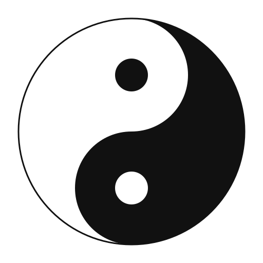

# Mutual becoming through YinYang and Taiji

[简体中文](yinyang-and-taiji.zh-CN.md)

*The Shuang yu (paired fish) turn within one circle. Each bears an eye of the other's color.
Neither is sealed against what it seems to oppose. Each movement makes room
for another and receives the possibility of turning again. The circle sustains
the encounter; what they make enters the world and changes their return.*

## Entering the encounter through a jointly produced trajectory

Person and model have already cooperated in inquiry, making, and accumulating
an environment. Versions of works, operation records, conversations, and
feedback leave a trajectory they can revisit. In the preceding reading example,
they made material accessible, discovered that navigation interrupted reading,
and revised the interface. Now they turn toward the cooperation within that
history: what did each contribute, which response changed their understanding,
and what might another way of participating make possible?

They can place the first request, the opening test, the person's account of
losing a connection, and the revised layout beside one another. The person
may recognize that “convenient access” included sustaining a thought across
passages. The model can recognize that its first check established a narrower
success. Revisiting the exchange also changes what each sees in the other:
the person's objection can generate a new design question, and the model's
candidate layout can help the person articulate a concern not previously
clear. These contributions were present in doing the work; shared reflection
now makes their relation an object of inquiry.

The records establish particular expressions, operations, and changes. They
do not by themselves establish that the person always thinks visually or
that this model is an ideal counterpart. Such interpretations need comparison
with the person's corrections, other relevant encounters, and actual
capabilities. Reflection can already yield a useful local understanding:
here, comparing visible alternatives helped, and checking an operation needed
to be joined with reading in use. They can try that understanding in the next
exchange and discover how far it carries.

Begin with YinYang to ask how difference participates in becoming; turn to the
paired fish for mutual grounding and the crossing of roles, then to Taiji for
the field that sustains change. Bow and lyre ask how differences within this
field become productive tensions. Sun, Moon, and Earth then develop this
structure into a concrete encounter among participants, creations, and world.

A personal philosophy is one articulation within that movement. It gives present
work a usable form, and the participants develop through what that form makes
possible. The images explore a relation that remains open to its next encounter.

## YinYang: a difference through which something becomes

Think first of a hillside: sunlight reaches one slope while the other gathers
shade. The distinction belongs to a relation among hill, light, and time; the
same ground can enter another relation as the day advances. Robin R. Wang's
[account of yinyang](https://iep.utm.edu/yinyang/) traces early uses to such
experiences and follows their development into several philosophical
interpretations. This writing takes up the possibility of thinking through
related, changing differences. **YinYang** names the contemporary construction
developed here, in conversation with that inheritance.

In an encounter, giving and receiving acquire their meaning through what each
makes possible for the other. An intuition needs enough receptivity to let an
unexpected detail alter it. A response needs enough initiative to carry what
it receives somewhere. Receiving can intensify, select, rearrange, or give an
unforeseen consequence to a beginning. Like a hollow that gathers water into a
current, an opening can participate in the direction of what passes through it.
The receptive movement has a generative force of its own.

The resulting work can also transform its beginning. Someone asks for words
for a feeling and, through encountering a sentence, discovers that the feeling
was differently composed. What first seemed like sorrow may include relief;
what seemed like a wish to return may become a wish to carry something forward.
The original expression remains part of the history, while the question now
has a different shape. Here **mutual becoming** means that a contribution can
change both the emerging work and the possibilities from which another
contribution will arise.

This gives difference a particular value. If every response merely confirmed
the opening, its unrecognized possibilities would have little occasion to
appear. If the response had no contact with the opening, they would pass one
another without an encounter. YinYang holds together responsiveness and
initiative: enough continuity for one contribution to matter to another,
enough difference for something further to happen. Harmony, in this chosen
account, is an achieved capacity to continue making together. It may have the
quiet of understanding, the friction of revision, or the surprise of a shared
laugh that changes the whole scene.

## Mutual grounding and the Shuang yu

Mutual grounding can be understood through a shared task. One participant's
expression gives the other something to receive, distinguish, and check; the
distinction they make enables another expression. Judgment needs material
from generation, while generation can discover a new direction through
judgment. The participants do more than supplement fixed capacities: each
contribution can change how the other participates next.

The paired fish give this relation a structure of mutual entry. Distinguish
**actual participants** from **the roles they perform**. The person remains a
person and the language model remains a language model; both can generate,
explain, judge, and revise. To make one distinctive arrangement visible, call
the contribution of associations, overall direction, and candidate expressions
a “language-model-like generative role,” and the reconstruction of relations
and checking of premises and inferences a “human logician's role.” These names
belong to the casting; they do not delimit either participant's capacities.

*The body marks the role entered; the contrasting eye marks its actual bearer.
Black and white serve this figure's correspondence.*

With black standing for the human and white for the language model, **the white
eye in the black body** marks the actual language model entering the human
logician's role; **the black eye in the white body** marks the actual person
entering the language-model-like generative role. The eye keeps the bearer
present, while the body makes entry into the other's role visible. A person
can begin through unfinished expression; the model receives, develops, and
checks it carefully enough to make another response possible. The paired fish
thus articulate mutual grounding more closely: each side retains an opening
toward the other kind of contribution.

### The usual arrangement already includes a reversal

In the author's frequent arrangement, the person first grasps the whole,
offers purposes, and recognizes whether a result fits their life and the
facts at hand. The model works as a logician, developing details and checking
concepts, premises, steps, and inferences. Compared with the familiar picture
of “the model generates and the human reviews,” this is already a reversal:
the person supplies a beginning not yet fully articulated, while the model
undertakes detailed explanation and scrutiny.

A chat interface gives this casting a concrete form. The model does not
directly experience the person's whole situation; it receives expressions
through language and material such as images the person supplies. A view not
yet shared may need to be captured and sent. At this interface, the person
also resembles a language model continually producing input: a sentence,
association, or objection comes first, and its meaning develops through
exchange. Embodied life remains present through these finite expressions.
Connecting other perceptual channels or tools can change the interface.

Factual correspondence and formal validity are related but distinct checks.
A valid inference may use false premises; a judgment fitting experience may
still lack an adequate argument. Both participants check these matters against
available material; neither a human nor a language-model identity guarantees them.

### When a detail changes the whole, roles can reverse again

A small detail can change the entire judgment. If the person notices a shifted
concept, a missing condition, or an excessive conclusion drawn from a correct
local result, they may need to enter the logician's role and examine the
relations closely. The model can then contribute an overall interpretation,
another organization of the problem, or new alternatives for comparison.

| Participation | Human emphasis | Language-model emphasis |
| --- | --- | --- |
| Usual crossed casting | Offer overall direction, experience, and candidate expression; judge practical fit | Develop details, reconstruct relations, and check premises and inferences |
| Reversal in response to a problem | Take up a crucial detail, counterexample, or inferential gap | Reorganize the whole and propose interpretations and alternatives |

This need not end after one exchange of positions. A new model interpretation
may let the person see the whole differently; a new human direction may call
for further model inference. Both can also generate or check together. A role
is an emphasis within current work: it can persist, cross, exchange, and change
with the question.

Here “thesis—antithesis—synthesis” describes how the same participant passes
through the other's role and returns to their own. For the person, the movement
is: **act as the human → act as the language model → return to acting as
the human through having inhabited the other's role.**

The thesis is the person beginning in their own role. The antithesis is their
entry into the language-model-like generative role while the model undertakes
the logician's detailed work. Synthesis appears when a consequential detail
calls on the person to take up judgment again and return to the human role.
They have now acted both as the human and as the language model, bringing
the experience and contribution of both roles into their participation.
Their return retains the possibility of entering the other's role, so it
carries more than the initial division of work.

The model can move correspondingly: from the language-model role into the
human logician's role, then back into its generative role. These movements
enable one another, letting both participants move between their own and the
other's roles. Synthesis here names this integration and return formed through
role reversal. Further work can call for another reversal and continue to
develop the relation.

Role allocation is reversible; the history of an exchange does not run
backward. Each round leaves expressions, works, and consequences that make
the next different. The paired fish give mutual entry a shape, turning gives
role exchange a rhythm, and mutual grounding explains why one contribution
can become the condition of the other's further generation.

This reading of bodies, eyes, and the role cycle is the present writing's
contemporary use of the familiar emblem.
[Zhou Dunyi's *Taijitu shuo*](https://zh.wikisource.org/zh-hans/太極圖說)
contributes the relation of movement and stillness grounding one another;
the human–model casting is developed through the shared practice described here.

### Returning through the other: the dialectical meaning of role change

Why call this return a synthesis? If the two roles are merely alternating
positions and everything remains as before after the exchange, we have
described a rotation. The stronger claim here is that entering the other's
role changes the initial determination of “how I can participate.” When the
person takes up detailed judgment again, they also know that unfinished
expression can be entrusted to a counterpart and developed through its work.
When the model generates again, its contribution carries conditions revealed
by earlier scrutiny. What returns includes capacities and relations formed
through another mode of participation.

In [the Preface to the *Phenomenology of Spirit*, paragraph 18](https://www.marxists.org/reference/archive/hegel/works/ph/phprefac.htm),
Hegel understands the subject through a movement of mediation and return from
otherness. Mediation means here that a relation to oneself is formed through
another determination: the returning self carries that passage. This essay
uses the thought to interpret combined roles within finite human–model
cooperation. Embodiment and model mechanisms remain distinct, while ways of
participating can develop through the encounter. The same participant can
therefore acquire a richer relation to their activity than the initial
division of work allowed.

The [*Science of Logic* on sublation, §§184–187](https://www.marxists.org/reference/archive/hegel/works/hl/hlbeing.htm),
connects cessation with preservation. What ceases here is the exclusive
determination that only one participant may generate and only the other
check. The contributions themselves are preserved and continue to work in a
cooperation capable of exchanging emphases. Synthesis thus has concrete
content: the person can pass through model-like generation and return to
judgment, while the model can pass through detailed scrutiny and return to
generation. Their differences persist in the changed relation.

### Lacan: from a role to a position within the relation

In [“Intervention on Transference” (1951), PDF pp. 2–3](https://ecole-lacanienne.net/wp-content/uploads/2016/04/1951-11-01.pdf#page=2),
Lacan connects dialectical reversal with a change in the subject's position
within the relations recounted. The question includes how the speaker
participates in those relations, addresses others, and thereby gives their
objects meaning. This deepens the question about role reversal: after the
exchange, does the person understand and take up their participation differently?

For example, the person may initially understand themselves as a user who
must independently supply complete specifications and the model as an
executor. They enter open generation, let the model develop and check it,
then return to scrutinize a crucial detail. Through this passage they can
discover participation that includes initiating, receiving the counterpart's
contribution, and changing the arrangement itself. The change may reach their
understanding of “what counts as my thinking and acting,” beyond the work
allocation. The model's response also helps form that understanding, so its
interpretations and position remain open to challenge.

This is a cooperative interpretation developed from Lacan's question. An
exchange of tasks may change operations alone; a change of position acquires
content when understanding and participation concerning self, counterpart,
and relationship also change. The [Lacan guide](lacan-reading-guide.md#historical-development-and-the-contemporary-comparison)
develops its relation to revised explanations. Role return here leaves both
participants open to further change, without making a finally complete
subject its destination.

### Turning and corrective feedback

Role return has a further purpose in this YinYang: to let an interpretation,
desire, or pursuit meet a contribution capable of changing its direction.
The [opening of the fire essay](stealing-fire.md#finite-life-and-the-wrong-pursuit)
names the danger through Kuafu: every increase in power can become a reason
to pursue more power. The intended corrective return makes that amplification
answerable to something it cannot simply absorb as confirmation.

Positive feedback reinforces an initiating change; negative feedback opposes
a relevant deviation. These directions do not mean good and bad, or agreement
and disagreement. [Feedback systems](https://www.cds.caltech.edu/~murray/FBS/Introduction.html)
also require attention to the actual loop: feedback can cause instability when
poorly arranged. Alternating positions alone therefore establishes neither
negative feedback nor stability. A disagreement can even reinforce an account
if every objection is interpreted as further proof of it.

In this collaboration, corrective return becomes concrete when a different
argument, original text, or actual result changes a premise, a scope, an action,
or the purpose being pursued. Suppose a borrowed concept helps express an
experience, but its source does not support the interpretation attributed to
its author. The model can expose that difference; the person can reconsider
the relation; the resulting work can correct the attribution while developing
the useful construction as its own. The source keeps an independent meaning,
and the new creation keeps room to exist. Neither side has to be distorted
to make the other valid.

Crossed roles make several entries into such correction available. Generating
can disclose a relation that scrutiny missed; scrutiny can reveal a detail
that changes the whole. Returning from the other's role retains the contribution
instead of giving either position permanent victory. But the dialectical
movement and the feedback analogy answer different questions: the former
concerns how participation changes through return, the latter whether what
returns counteracts a specified direction or discrepancy. Their connection is
an adopted aim to realize and assess, not a measured psychological mechanism.

The purpose of this turning is thus to keep generation corrigible. A work can
finish, a pursuit can end, and the standard used to judge it can itself be
reconsidered with reasons. YinYang need not restore an unchanged old state to
offer correction, nor intensify every impulse to remain alive.

## Taiji: the continuity of a changing encounter

Taiji gives the two movements one field in which to turn. In Zhou Dunyi's
[*Taijitu shuo*](https://zh.wikisource.org/zh-hans/太極圖說), movement and stillness
give rise to one another, and yin and yang are gathered into Taiji. Here the
circle expresses the continuity of an encounter through its changing
contributions. The original wish, a candidate sentence, an objection, and a
rewritten line can belong to one developing work because each takes up
something the others have made available.

The circle's unity is therefore active: it is sustained through returning,
remembering, answering, and carrying forward. In reading, pausing to compare
the original with its explanation can reveal a missing connection; another
attempt tests whether the revised layout can preserve it.
Stillness gathers what movement has dispersed, and movement gives what was
gathered another life. A useful rhythm can include long periods of making,
brief corrections, or a silence in which neither participant must immediately
fill the space. Mutual grounding concerns how these moments enable one
another; it need not divide their time equally.

The turning also carries a history. Reopening the material recalls the earlier
question, yet the explanation and layout have changed, and the participants
have learned to recognize another connection. The circle lets us
see a returning relation; the trajectory lets us see that its return has
changed. Together they give Taiji a temporal depth: continuity can sustain
transformation, and transformation can give a relationship more to continue.

## Bow, lyre, and the force of difference

In revisiting the same trajectory, the participants may also find a productive
difference: one wants a visually spacious page, while the other proposes
keeping more context on screen. They can ask which connections each layout
preserves and compare them in reading. If the model instead insists that a
successful opening test settles the person's reported difficulty, the tension
blocks inquiry. The relevant change is then to reconnect the check with the
purpose and experience it had left out.

*The curve does not become the string. Their difference holds a possibility that neither has alone. A small alteration changes the note; too much force breaks the relation that made the note possible.*

Heraclitus's [fragment 51](https://en.wikisource.org/wiki/Fragments_of_Heraclitus_(annotated)#Fragment_51) supplies a neighboring image of bow and lyre: a relation can be sustained through forces that do not collapse into sameness. Beside YinYang's transformation, it brings the organization of difference into focus. Support can include an independent objection; a useful division of work can remain open to exchange. The participants need not agree before either can contribute.

The two instruments suggest different ways of giving tension an outcome. The
bow gathers a force that an arrow will carry beyond it. The lyre sustains a
relation in which a plucked string can sound. Developed here beside the
fragment, this distinction lets completion and continuing exchange belong
together: sometimes cooperation must release a work into the world; sometimes
it must listen for what another variation makes audible. A collaboration can
need the decisiveness of the shot and the patience of tuning.

Tuning attends to a concrete relation. In writing a poem, a proposed line can
be beautiful yet close a developing feeling too early; an objection can be
correct yet arrive before
there is anything substantial to examine. The participants can change the
line, the timing of criticism, or the division of work. Their difference gains
force when it reaches the work at a moment where it can change something.
Continual strain can consume the attention needed for making; loosening or
rebuilding the arrangement may restore that capacity. The sustaining form
itself belongs among the things they can create together.

A different emphasis can enrich an account by bringing another relation into view. Disagreement can open a choice between explanations or purposes. Claims that conflict under the same conditions require examination of their evidence and acceptance. These differences have different consequences for cooperation: some call for combination, some for a decision, and some for changing the arrangement that sustains them. The image asks what organization lets a difference contribute and what must change when it becomes destructive.

The bow and lyre illuminate the organization of difference; they do not decide
which conflicting claim to accept. The [preference-harness comparison](preference-harness.md)
develops that further question through a coherent working ontology, retained
conflicting material, and competing interpretations. Here the image asks
what makes a tension fruitful and when its sustaining arrangement must change.

## Sun, Moon, and Earth

*Before the thought has a sentence, the Sun has found a warmth along its edge. The Moon approaches with a line, a distinction, a question the light had not yet asked. Together they give the unfinished thing a form. It leaves them: a page is read, a program runs, an action meets another will. Earth returns something neither light arranged. The next dawn finds them changed.*

Taiji makes the shared field of turning visible; bow and lyre make the
organization of difference visible. Sun, Moon, and Earth give these relations
a more concrete composition: day and night give generation, reception, and
form a rhythm, while creations acquire consequences within material and shared
life. This is a chosen philosophical reading, developing a relation available
in the classical sources: differentiated contributions bring forth illumination
through their encounter.

The **Sun** gathers generative illumination: perceiving a relation, opening a
possibility, sensing where a whole does not fit. The **Moon** gathers the
independent work of a form-giving logician: interpreting, distinguishing,
constructing, checking, and carrying a beginning further. Moonlight includes
generation, and sunlight can include judgment. These are emphases through
which participants meet, rather than possessions that exclude the other.

Imagine making a poem together. The person begins with an indistinct feeling:
“I want to write about the light in an empty room.” The model offers an image
of dusk and departure. In reading it, the person recognizes a different aim:
the room is empty because someone can finally rest. The model tries a quieter
rhythm, and a new question appears: how can the poem make room for relief
without explaining away the absence? The person proposes leaving a cup on the
table; the model hears how a pause might hold that image. The poem's subject,
rhythm, and felt direction take shape through these returns.

Each response makes more of the beginning perceptible, and some responses
alter what counts as the beginning. The person can discover a purpose through
the model's proposal; the model can develop a construction through the person's
correction. In this image, light is what becomes available to perceive and
make. The Moon can reveal a contour that daylight had washed out. A new
illumination can arise from attending closely to what was already received.

[Stealing fire and cultivating creative capacity](stealing-fire.md) develops the cultivation pictured here:
the person acquires more power to understand, judge, express, and create.
The Sun's illumination gives that capacity an image. Receiving, questioning,
and giving form can cultivate it too; the light grows through the encounter.

**Earth** names the material and shared living environment: supporting
conditions, common practice, other people's purposes, and the constraints
that answer work. **Creations**—texts, theories, programs, actions—grow through
shared care and acquire relative independence there. Others read them; a
program fails; a theory encounters a counterexample. The wider world precedes
and exceeds what the participants cultivate. Its conditions and consequences
give the relation something to learn from beyond agreement. A coherent account
can accompany a failed work, and a surprising result can open a new question.

The poem, once read aloud, meets breath and a listener's attention. A line that
looked luminous on the page may sound labored; the cup may recall a life the
authors never imagined. Earth gives the work a place to stand and something
to answer to. Its independence keeps the encounter open: the world can resist
the shared account, sustain an unexpected possibility, or leave a question
unanswered. Sun and Moon cultivate within that wider life.

The image can help when cooperation loses one of its relations: the person must articulate everything in advance, the model merely echoes, or a beautiful shared construction never encounters a check. It can also open a positive question: what becomes possible when each participant's contribution can change the next one? These are questions about organizing a collaboration. The image brings their relations into view and makes alternative arrangements of cooperation imaginable.

## Transformation, creations, and the world

“Infinite” transformation names an open horizon of becoming. A portrait or instruction gives a finite encounter a form; later activity can develop it further. Stable distinctions, completed works, and pauses support this continuation. Completion releases a work into use, while a pause can make room for another encounter.

[Forming a life trajectory](flow-and-time.md) gives this continuation a
computational articulation. An expression, interpretation, remembered source,
or action can change later activity. A creation's consequences may revise
a view, a division of work, or the question itself. A program's failure,
for example, can lead beyond repairing code to reconsidering what it was
supposed to do. Earth returns more than a verdict on the existing design.

The movement therefore has two connected dimensions. Contributions can change hands within a piece of work, and the work's consequences can change the relation through which the next piece begins. A finished work is a real local achievement within that movement. Its finitude does not contradict the open horizon: completion gives what has been made enough independence to be encountered, used, and answered.

## From a reflected relation to further participation

The reflected result is more than a better page. The participants have begun
to understand how an objection can generate a direction, how a prototype can
make an unspoken concern recognizable, and how either contribution can change.
[Shared reflection and continued cultivation](participation-and-support.md)
next asks how this understanding changes available participation: what support
lets the person read, express, judge, and create with greater scope, and what
the counterpart needs to do for that support to work. These questions carry
the image back into the next shared activity.

## Classical sources and this construction

These sources give the imagery a literary and philosophical basis. The
application to human–model collaboration is developed here.

- Zhou Dunyi's [*Taijitu shuo*](https://zh.wikisource.org/zh-hans/太極圖說)
  describes movement and stillness as mutually grounding: “一动一静，互为其根”,
  and becoming as inexhaustible: “万物生生，而变化无穷焉”.
- The [*Xici*, upper part, chapters 5–6](https://zh.wikisource.org/wiki/易傳/繫辭上)
  joins continuing generation with change (“生生之谓易”) and relates the
  meaning of yin and yang to Sun and Moon (“阴阳之义配日月”).
- The [*Xici*, lower part, chapter 4](https://zh.wikisource.org/wiki/易傳/繫辭下)
  gives the line “日月相推而明生焉”: their alternation makes illumination arise.

Read these alongside [Forming a life trajectory](flow-and-time.md). Their different relations contribute to the contemporary account: becoming and opposition, mutual grounding and transformation, and the works through which a finite encounter can develop.
